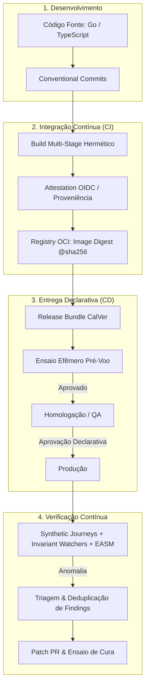
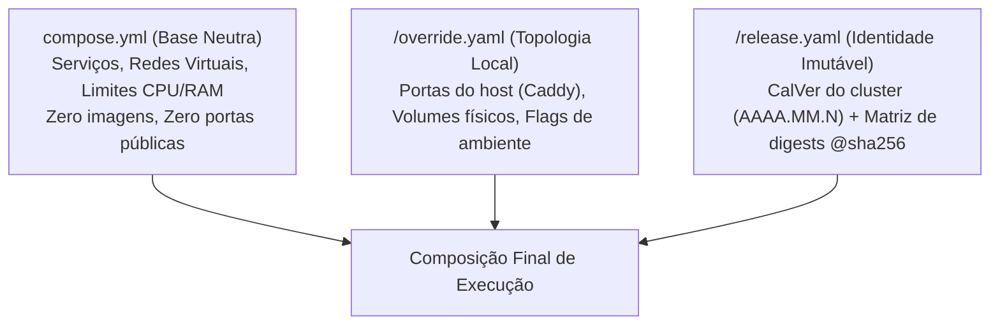
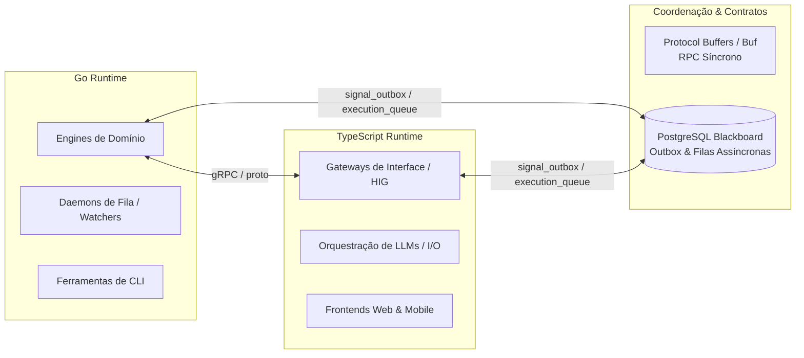
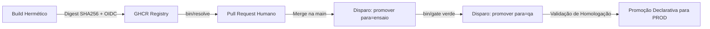
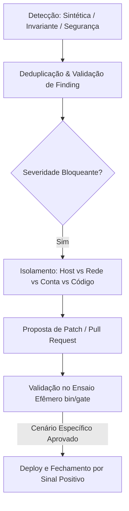

# PADRÃO DE PROJETO LABS (LABS ARCHITECTURAL STANDARD)

**Classificação:** Norma Canônica de Engenharia, DevOps e Arquitetura de Software  
**Status:** ATIVO / CANÔNICO  
**Última Revisão:** Outubro de 2026  

---

## Guia Rápido: Como o Labs Constrói e Roda Software

Este documento é a referência definitiva de engenharia para qualquer desenvolvedor ou operador no Labs. Ele descreve como nosso código é estruturado, empacotado, promovido e mantido saudável em produção sem atrito e sem intervenção manual não rastreada.

### O Ciclo de Vida em uma Imagem


---

## 1. Princípios Fundamentais (Os Axiomas Labs)

1. **Supremacia da Imutabilidade:** Nenhum ambiente de execução roda tags móveis (`:latest`, `:main`, `:v1`). Cada contêiner aponta exclusivamente para seu digest criptográfico (`image@sha256:...`). O que foi testado é rigorosamente o que vai para o ar.
2. **Anti-Overengineering Pragmático:** Decisões simples e resilientes têm prioridade sobre tendências de mercado. Evitamos orquestradores distribuídos complexos e brokers externos enquanto padrões locais e transacionais (PostgreSQL Blackboard + Outbox) suprirem os requisitos com confiabilidade.
3. **Hermetismo e Defesa em Profundidade:** Builds reproduzíveis, contêineres sem shell (Distroless) ou estritamente não-root, e segredos criptografados na ponta (SOPS/Age) montados em memória volátil (`tmpfs`).
4. **Verificação Pré-Voo Bloqueante:** Nenhuma mudança atinge um ambiente persistente sem ser validada em um ensaio efêmero descartável com banco real e execução de migrações.

---

## 2. Topologia de Ambientes e Gerenciamento de Configuração

A definição de ambientes independe de onde o hardware reside (seja máquina local, VPS ou instância em nuvem). O que define o ambiente é o seu papel, suas garantias de isolamento e o tratamento do seu estado.

### 2.1. Matriz de Ambientes

| Ambiente | Objetivo & Papel | Garantia de Imutabilidade | Segredos & Efeitos Colaterais | Banco de Dados & Estado |
| :--- | :--- | :--- | :--- | :--- |
| **DEV** | Trabalho diário e ciclo rápido de feedback do desenvolvedor. | Consome o bundle de imagens pinadas com override permissivo. Suporta hot-reload apenas compilando código-fonte local. | **Offline / Mocked:** Provedores de LLM, e-mails e alertas desativados. Segredos sintéticos em memória (`tmpfs`). | Banco efêmero criado e apagado sob demanda. Zero dados reais. |
| **ENSAIO** | Sandbox descartável para validação pré-voo bloqueante (`ensaio-<run>`). | Roda **rigorosamente** os digests `@sha256:...` candidatos à promoção. | Segredos sintéticos em runtime. **Sem portas publicadas no host** (rede fechada). | Banco limpo; roda todas as migrações e valida o boot completo dos serviços sob `trap` de destruição. |
| **QA** | Espelho operacional estável para homologação de produto. | **Estrita:** O manifesto `qa/release.yaml` dita o estado. Mudanças entram só via Pull Request humano aprovado. | Segredos reais de homologação cifrados via SOPS/Age. Serviços externos conectados em modo Sandbox. | Banco persistente com rotina de backup preventivo antes de qualquer migração. |
| **PROD** | Ambiente canônico de atendimento a usuários finais. | **Absoluta:** Nenhum digest é recalculado. Promoção por cópia do manifesto já estabilizado em QA. | Segredos de produção de privilégio máximo descriptografados apenas em `tmpfs 0600`. | Banco canônico com HA e arquivamento contínuo de WAL. Rollback declarativo garantido. |

### 2.2. O Trio de Manifestos (Environment-as-Code)
Todo ambiente é inicializado pela composição de três arquivos declarativos:
```sh
docker compose -f compose.yml -f <env>/override.yaml -f <env>/release.yaml config
```



---

## 3. Tech Stack Canônica e Divisão de Responsabilidades

O Labs rejeita o ecletismo desgovernado. A arquitetura opera sob um duopólio técnico estrito entre **Go (Golang)** e **TypeScript (Node.js)**.



### 3.1. Go (Golang) — O Motor de Domínio e Infraestrutura
- **Domínio:** Engines de negócio, daemons em background, orquestradores, watchdogs de integridade, serviços de alta concorrência e ferramentas CLI.
- **Por que usamos:**
  - *Binário Hermético:* Compilação limpa (`CGO_ENABLED=0`) gerando binário único sem dependências dinâmicas do sistema operacional.
  - *Pegada Mínima:* Imagens baseadas em Alpine não-root (`USER engine`) < 25MB, inicialização instantânea e baixo consumo de RAM.
  - *Concorrência Nativa:* Goroutines e channels nativos para processamento em lote e consumo de banco (`FOR UPDATE SKIP LOCKED`).
  - *Compilação Cruzada:* `GOOS` e `GOARCH` nativos no host de build sem emulação.
- **Fronteira Proibida:** Expressamente vedado o uso de Go para renderização de UI dinâmica, SSR ou estilização de interfaces.

### 3.2. TypeScript / Node.js — A Camada de Interface e Integração
- **Domínio:** Gateways de interface (Human Interface Gateway - HIG), APIs para clientes externos, orquestração de provedores de IA/LLM e frontends web/mobile (React, Expo).
- **Por que usamos:**
  - *Contratos Tipados:* Schemas ponta a ponta (Zod) compartilhados entre backend de borda e cliente.
  - *Ecossistema de I/O Assíncrono:* Integração natural com SDKs de APIs externas e modelos de linguagem.
  - *Segurança com Distroless:* Empacotamento sobre `gcr.io/distroless/nodejs24:nonroot`, sem shell (`/bin/sh`) e sem gerenciadores de pacote.
- **Fronteira Proibida:** Proibido o uso de TypeScript para daemons de longa duração com computação pesada de CPU ou controle transacional de processos e sockets de baixo nível.

### 3.3. Comunicação Entre Runtimes
1. **Chamadas Síncronas:** Protocol Buffers gerenciados via **Buf** (`buf.yaml`), gerando contratos tipados para Go e TypeScript.
2. **Coordenação Assíncrona:** Mediada pelo PostgreSQL através do padrão **Transactional Outbox Dual** (`signal_outbox` para eventos e `execution_queue` para tarefas).

---

## 4. Containerização, Eficiência e Higiene de Runtime

O Dockerfile é a primeira linha de defesa hermética e de performance do Labs.

### 4.1. Eficiência Crítica de Build
1. **Multi-Arch sem QEMU:** O estágio `builder` roda sempre em `--platform=$BUILDPLATFORM`. O Go e o Node utilizam compilação cruzada nativa. A imagem final contém exclusivamente instruções `COPY`, garantindo que binários da arquitetura alvo nunca executem durante o build.
2. **Cache Desacoplado com `COPY --link`:** Camadas de arquivos copiadas com `--link` são independentes e não têm seu cache invalidado por atualizações nas imagens base.
3. **Cache Mounts Persistentes (`--mount=type=cache`):** Caches locais de compiladores (`/go/pkg/mod`, `/root/.cache/go-build`, pnpm store) persistem entre builds sem inflar a imagem final.
4. **Ordenação de Invalidação:** Copiar arquivos de dependências (`go.mod`, `package.json`) e instalar dependências antes de copiar o código-fonte da aplicação.

### 4.2. Segurança e Hermetismo
1. **Injeção de Credenciais em `tmpfs`:** Segredos e deploy keys entram via BuildKit Secret montados em memória temporária volátil:
   ```dockerfile
   RUN --mount=type=secret,id=go_private_keys,required=true \
       --mount=type=tmpfs,target=/run/chave \
       eval "$(go-private-keys /run/secrets/go_private_keys /run/chave)" && \
       go mod download
   ```
2. **Host Keys Pinadas:** Chaves de host do Git (`ssh-ed25519` do GitHub) são pinadas em `/etc/ssh/ssh_known_hosts` para evitar MitM no download de módulos privados.
3. **Binários Stripped:** Binários Go compilados com `-trimpath` e `-ldflags="-s -w"`, eliminando caminhos do host de compilação e tabelas de debug.

### 4.3. Runtimes Mínimos e Higiene Anti-OOM / Anti-Leak
1. **Runtimes Não-Root:**
   - Go: `alpine:3` com usuário não-root explicitamente provisionado (`USER engine`, UID 100).
   - Node: `gcr.io/distroless/nodejs24:nonroot` (`USER 65532:65532`), sem shell.
2. **Init System Mandatório (`tini`):** Todo contêiner que gerencia subprocessos ou tarefas automatizadas deve rodar com um init reaper como PID 1 para colher processos zumbis (`waitpid`) e tratar sinais POSIX.
3. **Limites de Heap:**
   - Node: `ENV NODE_OPTIONS="--max-old-space-size=<MB>"` fixado em ~75% do teto de memória do container.
   - Go: `ENV GOMEMLIMIT=<MB>` para calibrar a atuação do Garbage Collector.
4. **Limites Obrigatórios no Compose:** Todo serviço em `compose.yml` deve declarar `limits.memory` e política de reinício `restart: unless-stopped` combinada com `healthcheck`.

### 4.4. O Padrão Toolbox (Uma Imagem, Múltiplos Daemons)
Em vez de construir e distribuir múltiplas imagens para microsserviços do mesmo domínio, consolidamos os daemons em uma única imagem de release sem `CMD` padrão. O `compose.yml` define o papel de cada instância pelo comando (`command: orchestrator`, `command: watchdog`, `command: migrate`). A imagem carrega em `/usr/share/<app>/` os esquemas SQL e contratos Protobuf compartilhados.

---

## 5. Proveniência Criptográfica e Ciclo de Promoção

### 5.1. Pinning Criptográfico e Assinatura OIDC
- Toda imagem em manifests de ambiente usa exclusivamente `repo/imagem@sha256:<hash>`.
- Ao publicar no GHCR, o pipeline solicita um token OIDC criptográfico assinado pelo GitHub (`audience` = digest da imagem) e o anexa ao registro como um **OCI Referrer** (SLSA Nível 3).
- O runner de deploy valida a assinatura (`bin/prova`) contra as chaves públicas JWKS do GitHub antes de autorizar a execução.

### 5.2. O Pipeline Declarativo de Promoção
Nenhum workflow automatizado tem permissão de escrita direta na branch `main` de repositórios de ambiente.



1. **Resolução de Versão (`bin/resolve`):** O operador resolve as imagens candidatas para seus digests criptográficos e gera a versão de calendário (CalVer: `AAAA.MM.N`) em `qa/release.yaml`.
2. **Pull Request Humano:** A atualização do manifesto é submetida via PR aberto por membro autorizado, passando por revisão e checks estritos (`bin/checa`).
3. **Pré-Voo Bloqueante (`para=ensaio`):** O workflow instancia o cluster efêmero descartável (`bin/gate`), roda as migrações de banco e testa os probes `/healthz`. Falhas abortam o processo sem impactar homologação.
4. **Aplicação com Safeguards (`para=qa`):**
   - Autorização estrita via RBAC (`bin/autoriza` checando `labs.txt`).
   - Runner dedicado e monitorado (`bin/vigia-runner`).
   - Backup preventivo de dados antes da aplicação (`bin/aplica`).
   - Subida com `docker compose up --wait` e auto-rollback imediato em falha de inicialização.
5. **Promoção para Produção (PROD):** Produção não resolve imagens novas nem recompila código; recebe uma cópia fiel do manifesto `release.yaml` comprovado e homologado em QA.

---

## 6. Ingress, Borda de Rede e Gerenciamento de Tráfego

### 6.1. Exposição Mínima de Borda
Apenas o proxy reverso (Caddy) expõe portas no host público. Todos os bancos de dados, gateways internos, workers e daemons operam exclusivamente em redes virtuais isoladas (`networks: [internal]`). Serviços que precisam de acesso externo residem em redes com permissão explícita de saída (`networks: [internal, egress]`).

### 6.2. Roteamento Same-Origin e Cache RFC 9111
Para evitar complexidades de CORS e cabeçalhos inseguros, o Caddy atende a origem de forma unificada:
- `/healthz`: Roteado ao gateway interno sem autenticação (usado para sondas de deploy).
- `/api/*`: Roteado para o gateway interno com remoção de prefixo.
- Demais rotas: Roteadas para o servidor de arquivos estáticos da SPA.

Configuração de cabeçalhos de cache:
- **Assets com Hash (ex: `/_expo/static/*`):** `Cache-Control: "public, max-age=31536000, immutable"`.
- **Entrypoints da SPA (`index.html`):** `Cache-Control: "no-cache"`, garantindo que novos deploys sejam refletidos imediatamente sem telas brancas nos clientes.

---

## 7. Gestão de Segredos e Configurações

1. **Zero Segredos em Plaintext:** Arquivos `.env`, credenciais de banco ou chaves de API nunca são commitados descriptografados.
2. **Criptografia SOPS + Age:** Segredos de cada ambiente moram no repositório criptografados como `<env>/segredos.sops.env`.
3. **Descriptografia In-Memory:** Durante o deploy, os segredos são descriptografados diretamente para arquivos com permissão estrita `0600` em memória temporária volátil (`tmpfs`), destruídos imediatamente ao término da aplicação (`trap 'rm -rf "$T"' EXIT`).

---

## 8. Verificação Contínua e Auto-Cura (Continuous Verification & Remediation)

Não dependemos de monitoramento passivo ou de alertas de usuários. A estabilidade e segurança do ecossistema operam por **verificação contínua e desacoplada**.

### 8.1. Os Três Pilares de Verificação
1. **Synthetic User Journeys (Sondagem Ativa de Caixa-Preta):** Emulação automatizada de jornadas completas de clientes e parceiros sob agendamento isolado (`flock`), medindo integridade de telas, regressões de fluxo e orçamentos de latência de transição (< 3s).
2. **Invariant Watchers (Inspeção Profunda de Caixa-Branca):** Daemons internos que auditam continuamente as invariantes relacionais no PostgreSQL, o esvaziamento saudável do Transactional Outbox e a consistência entre schemas.
3. **Continuous Attack Surface Management - EASM (Segurança Contínua):** Varredura de exposição de DNS/bordas, auditoria contínua de credenciais vazadas em repositórios, análise de CVEs em imagens e fiscalização de políticas de IAM contra shadow IT.

### 8.2. O Contrato Universal do Achado (`Finding`)
Toda anomalia identificada é registrada em um repositório padronizado de achados:
- **Estrutura:** `frente`, `alvo`, `regra`, `titulo`, `severidade` (`CRITICAL` a `INFO`), `prova` (passos reprodutíveis, cURL com trace ou log) e `CAMPOS_CHAVE`.
- **Deduplicação & Relógio de Envelhecimento:** O motor agrupa achados pela mesma chave e reporta apenas o delta (*entrou*, *saiu*, *envelheceu*), eliminando tempestades de notificações redundantes.
- **Sigilo:** Valores reais de credenciais nunca são armazenados, apenas hashes e fingerprints.

### 8.3. Tripwires de Leitura e Proteção de Produção
- **Somente-Leitura em Produção:** Sondas sintéticas abortam instantaneamente se qualquer requisição não-GET for emitida fora de fluxos de login isolados.
- **Operações com Efeito Colateral:** Mutações de dados para testes em produção exigem parâmetros explícitos (`--commit`), duplo gate de aprovação e saldo sintético isolado.

### 8.4. O Ciclo de Remediação


1. **Isolamento Sistemático:** Diagnóstico antes de culpar código: isolar se a falha é do cliente de teste, da conectividade/gateway, de permissões de conta ou de regressão real de software.
2. **Validação no Ensaio:** O patch corretivo deve rodar no ambiente descartável (`cutover-ensaio-<run>`) e comprovar a aprovação do **cenário exato que falhou**.
3. **Fechamento Positivo:** O achado só é dado como resolvido após **3 ciclos consecutivos de sucesso ininterrupto** em ambiente estável.

---

## 9. Checklist de Conformidade Labs (Definition of Done de Infraestrutura)

Antes de qualquer serviço, módulo ou aplicação ser promovido para homologação no Labs, ele deve atender a:

- [ ] Workflows de CI/CD herdam dos repositórios centrais pinados por commit SHA de 40 hexadecimais.
- [ ] Dockerfile adota multi-stage build sobre Alpine não-root (`USER engine`) ou Distroless Node 24 (`USER 65532`).
- [ ] Compilação multi-arch utiliza `--platform=$BUILDPLATFORM` sem emulação QEMU.
- [ ] Segredos de build são injetados exclusivamente via BuildKit Secret em `tmpfs`.
- [ ] Imagens publicadas no GHCR possuem prova de proveniência OIDC anexada como OCI Referrer.
- [ ] Nenhuma porta de banco de dados ou serviço interno está exposta para o host público.
- [ ] Manifesto de ambiente aponta exclusivamente para digests imutáveis (`image@sha256:...`).
- [ ] Deploy testado e aprovado previamente via sandbox efêmero (`bin/aplica ensaio`).
- [ ] Borda Caddy configurada com isolamento same-origin e cabeçalhos RFC 9111.
- [ ] Todo serviço em `compose.yml` declara limites estritos de memória (`limits.memory`).
- [ ] Contêineres com múltiplos processos ou workers utilizam init reaper (`tini`) e limites de heap configurados.
- [ ] Serviços expõem probes `/healthz` e métricas compatíveis com invariant watchers.
- [ ] Rotinas críticas possuem cenários de verificação sintética e varredura de segurança homologados.
- [ ] Repositório traz arquivo LICENSE proprietário da WIBX Company na raiz e ausência de menção a autores individuais no código.

---

## 10. Higiene de Código, Autoria e Propriedade Intelectual

Todo repositório mantido ou criado sob o padrão Labs pertence exclusivamente à **WIBX Company**. A organização do código reflete titularidade corporativa estrita e documentação focada em regras de negócio, não em histórico pessoal.

### 10.1. Titularidade e Licenciamento (Padrão Híbrido)
1. **Arquivo de Licença na Raiz:** Todo repositório deve conter na raiz um arquivo `LICENSE` proprietário declarando a titularidade da WIBX Company e a vedação explícita de cópia, redistribuição, engenharia reversa ou uso não autorizado.
2. **Pacotes Privados:** Manifestos de dependências (`package.json`, etc.) devem declarar explicitamente `"private": true` e `"license": "UNLICENSED"`.
3. **Cabeçalhos por Arquivo:**
   - **Novos repositórios e módulos:** Não exigem cabeçalho de copyright linha a linha, mantendo o código limpo e aderente à prática lean da indústria.
   - **Repositórios legados com cabeçalho já ativo:** Mantêm os cabeçalhos existentes (`// © 2026 WIBX Company. Todos os direitos reservados.`), sem necessidade de limpeza retroativa.
4. **Entidade Única:** O código pertence à `WIBX Company`. Razões sociais jurídicas específicas são restritas a contratos legais, Termos de Uso e documentos fiscais.

### 10.2. Regras de Código e Comentários
1. **Sem Autoria Individual:** É expressamente vedado o uso de `@author`, nomes ou e-mails de desenvolvedores no código. O histórico do Git é a fonte canônica de autoria técnica.
2. **Comentários de Domínio:** Comentários técnicos (TSDoc, Godoc) devem focar no **porquê** de regras de negócio, invariantes de segurança e contratos de API, evitando narrativas de histórico ("alterado por X") ou redundância sintática.

