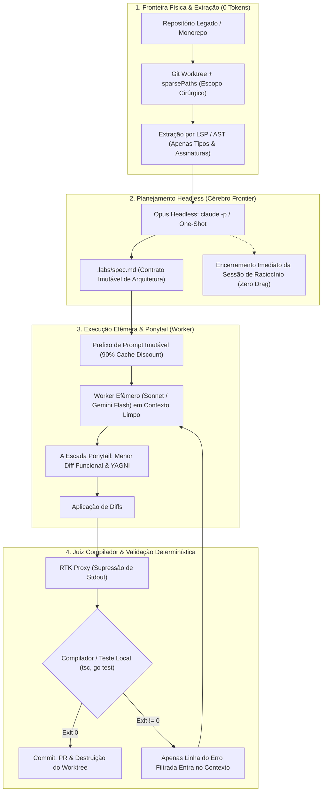

# PADRÃO DE ENGENHARIA DE CONTEXTO E USO DE IA (LABS AI & CONTEXT STANDARD)

**Classificação:** Norma Canônica de Engenharia de Contexto, Governança de Tokens e Automação Agêntica  
**Status:** ATIVO / CANÔNICO (EM REFINAMENTO CONTÍNUO)  
**Última Revisão:** Outubro de 2026  

---

## Guia Rápido: Como o Labs Opera com Inteligência Artificial

Este documento define a governança técnica para todo desenvolvimento assistido ou conduzido por modelos de linguagem (LLMs) e agentes autônomos no Labs. Seu objetivo primário é duplo: **eliminar a degradação de código causada por janelas de contexto saturadas (*Lost in the Middle* e *Context Poisoning*)** e **impedir o esgotamento de cotas semanais e limites de computação (Claude Max 20 / APIs frontier)**, sem reduzir a velocidade de entrega, a autonomia ou a ambição dos projetos.

### O Ciclo Operacional em uma Imagem (A Regra de Ouro)



---

## 1. Princípios Fundamentais (Os Axiomas de Contexto Labs)

1. **Supremacia da Severidade de Processo (*Process Severance*):** O processo que explora arquitetura e define contratos nunca compartilha o histórico conversacional com o processo que implementa código. Planejadores frontier operam em modo headless efêmero (`claude -p`), gravam o contrato estático (`.labs/spec.md`) e encerram a sessão imediatamente.
2. **Soberania do Determinismo Local:** O que um compilador (`tsc --noEmit`, `go test`), linter, AST ou script de shell avalia via código de saída binário (`exit 0` vs. `non-zero`) com latência zero e custo zero de tokens jamais deve ser delegado a um LLM ou modelo discriminativo externo.
3. **Invariância de Prefixo e Continuidade de Cache:** Regras de projeto (`CLAUDE.md`, `GEMINI.md`) e especificações técnicas de tarefas residem no topo imutável do prompt. Isso maximiza a retenção de atenção e garante determinismo no desconto de 90% de Prompt Caching. A auto-compactação reativa de histórico é proibida como substituta de boa arquitetura de sessão.
4. **Cercamento Físico de Fronteira (*Zero-Token Fencing*):** É terminantemente proibido permitir que agentes façam buscas cegas (`grep -rn` aberto, `find .`) sobre monorepos ou bases legadas. O sistema de arquivos deve ser cercado previamente via `git worktree` e `sparsePaths`, e a navegação estrutural deve ser conduzida exclusivamente por símbolos de Language Server Protocol (LSP).
5. **A Disciplina do Menor Diff Funcional (Doutrina Ponytail):** O melhor código é o código não escrito. Toda geração de código é governada pela rejeição ativa a abstrações especulativas, boilerplate desnecessário e duplicação de utilitários que a biblioteca padrão ou o codebase já oferecem.

---

## 2. A Física da Janela de Contexto (Fundamentos Teóricos)

A administração de contexto não é uma preferência estética ou contábil; é uma restrição de engenharia imposta pela arquitetura interna dos transformadores de atenção (*Attention Mechanisms*).

### 2.1. O Fenômeno *Lost in the Middle*
Conforme uma sessão atinge dezenas de turnos e ultrapassa de 40.000 a 60.000 tokens, a capacidade do modelo de recuperar e obedecer instruções localizadas no terço médio da janela degrada acentuadamente.
* **Mecanismo:** A atenção é naturalmente concentrada no início do prompt (efeito de primazia) e no final imediato (efeito de recência).
* **Impacto em Engenharia:** Invariantes críticas de banco de dados, regras de segurança e restrições de arquitetura definidas nos primeiros turnos de uma sessão longa são progressivamente esquecidas pelo modelo, resultando em código que compila mas viola o design do sistema.
* **Mitigação Labs:** O contrato técnico (`.labs/spec.md`) é montado no topo imutável da janela do worker, mantendo as diretrizes na zona de primazia durante todo o ciclo de vida da tarefa.

### 2.2. Envenenamento de Contexto (*Context Poisoning* & *Cascading Failures*)
Em sessões multi-turn interativas, se o modelo emite uma inferência incorreta, gera um patch com erro de sintaxe ou recebe um stack trace de 300 linhas de um terminal não filtrado, esse resíduo passa a compor a distribuição de probabilidade dos próximos tokens.
* **Mecanismo:** O modelo condiciona sua próxima resposta a ser coerente com o histórico existente — incluindo os erros e falsas premissas anteriores.
* **A Regra Labs:** **Contexto contaminado não se conserta conversando.** Quando uma sessão entra em loop de correções remendadas, a sessão deve ser destruída e reiniciada a partir do contrato estático em disco.

### 2.3. A Equação da Queima de Tokens
A queima acelerada de cotas semanais (como o Claude Max 20) decorre da ressubmissão cumulativa:
$$\text{Tokens Faturados por Turno } N = \text{Prefixo Fixo} + \sum_{i=1}^{N-1} (\text{Prompt}_i + \text{Resposta}_i) + \text{Saídas de Ferramentas}_N$$

Em uma sessão monolítica de 15 turnos executada no Opus, o desenvolvedor paga o custo de raciocínio estendido sobre dezenas de milhares de tokens repetidos a cada interação. A severidade de processo transforma esse comportamento em $N$ execuções isoladas de baixo contexto em workers mais rápidos (Sonnet/Flash), preservando a cota frontier apenas para a fase de raciocínio puro.

---

## 3. A Topologia Canônica em 4 Camadas

```
┌────────────────────────────────────────────────────────────────────────┐
│ Camada 1: Fronteira Física & Extração Local                            │
│ (Git Worktrees, sparsePaths, LSP, Tree-sitter)                         │
│ ──► Custo: 0 Tokens. Impede o vazamento de monorepos legados.          │
└───────────────────────────────────┬────────────────────────────────────┘
                                    │ Tipos e assinaturas cirúrgicas
                                    ▼
┌────────────────────────────────────────────────────────────────────────┐
│ Camada 2: Contrato Arquitetural & Roteamento Cognitivo                 │
│ (Opus Headless: `claude -p` > .labs/spec.md, Sub-Agent Pinning)        │
│ ──► Custo: Turno único Frontier. Zero herança conversacional.          │
└───────────────────────────────────┬────────────────────────────────────┘
                                    │ Especificação imutável (.labs/spec.md)
                                    ▼
┌────────────────────────────────────────────────────────────────────────┐
│ Camada 3: Execução Efêmera, Cache Quente & Ponytail                    │
│ (Sonnet/Flash em sessão limpa, Escada de 7 Degraus, Cache Anchor)      │
│ ──► Custo: Taxa de Worker com 90% de desconto em leituras de cache.    │
└───────────────────────────────────┬────────────────────────────────────┘
                                    │ Patches de código & Diffs
                                    ▼
┌────────────────────────────────────────────────────────────────────────┐
│ Camada 4: Juiz Compilador & Supressão Determinística                   │
│ (RTK CLI Hooks, `tsc --noEmit`, `go test`, Exit Codes)                 │
│ ──► Custo: 0 Tokens em sucesso; apenas erro estrito na falha.          │
└────────────────────────────────────────────────────────────────────────┘
```

### 3.1. Camada 1: Fronteira Física & Extração Local
* **Git Worktrees Isolados:** Toda refatoração pesada opera em uma árvore de trabalho separada (`git worktree add ../feature-branch feature-branch`). Isso garante que operações concorrentes ou arquivos temporários não colidam com o branch principal.
* **`worktree.sparsePaths`:** Quando operando em monorepos, o arquivo de configuração do harness trava o checkout apenas nos diretórios diretamente impactados (ex.: `packages/engine-core`).
* **LSP sobre Grep:** Para localizar definições de structs, interfaces ou chamadas de função, o agente deve invocar comandos de LSP (`textDocument/definition`) ou Tree-sitter. Extrai-se a assinatura exata de 15 tokens em vez de injetar um arquivo de 1.000 linhas ou um log de grep com 200 ocorrências dispersas.

#### 3.1.1. O Papel de Grafos Semânticos (Joern, Graphify, Cartographer)
Ferramentas de análise estrutural profunda não são plugins para conversar em tempo real; são **oráculos determinísticos de pré-processamento local**:
1. **Joern (Code Property Graph - CPG):**
   * *O que faz:* Combina AST (árvore sintática), CFG (fluxo de controle) e PDG (dependência de dados) em um grafo formal consultável via CPGQL.
   * *O Risco de Contexto:* Injetar nós de CPG ou dumps brutos de grafo no prompt destrói a janela com dezenas de milhares de tokens ilegíveis.
   * *O Uso Correto no Labs:* Execução local em CLI para rastrear taint analysis, callers profundos ou impacto de refatoração. Apenas o **slice de 3 a 5 linhas resultantes da consulta** entra no prompt do Opus na Camada 2.
2. **Graphify:**
   * *O que faz:* Gera um mapa relacional do projeto (`graphify-out/graph.json`).
   * *O Uso Correto no Labs:* Não alimentar o JSON inteiro para o LLM. Consultar o arquivo via `jq` ou script local para extrair estritamente os acoplamentos de 1º grau do módulo antes de acionar a Camada 2.
3. **Cartographer / Mapeamento de Sub-sistemas:**
   * *O que faz:* Gera mapas visuais de arquitetura e fronteiras de domínio.
   * *O Uso Correto no Labs:* Opera como gerador de documentação estática e balizador de `sparsePaths`. Seus diagramas (Mermaid) moram em `docs/` e são lidos sob demanda, nunca injetados cegamente no boot de toda sessão.

### 3.2. Camada 2: Contrato Arquitetural & Roteamento Cognitivo
* **Execução Headless do Modelo Frontier:** O modelo de maior capacidade de raciocínio (Opus) é invocado exclusivamente para síntese, diagnóstico e planejamento de alto nível de forma não interativa:
  ```bash
  claude -p --model opus "Analise as interfaces em $CONTEXT e gere o plano de migração conforme o template Labs" > .labs/spec.md
  ```
* **Encerramento de Sessão:** O processo do Opus encerra no momento em que o arquivo `.labs/spec.md` é gravado. O Opus nunca é mantido aberto para "digitar código" ou "ajustar ponto e vírgula".

### 3.3. Camada 3: Execução Efêmera, Cache Quente & Ponytail
* **Sessão do Worker:** O agente de execução (Sonnet ou Gemini Flash) é inicializado em uma sessão limpa, recebendo como contexto apenas:
  1. O arquivo canônico de regras (`CLAUDE.md` ou `AGENTS.md`).
  2. O arquivo de especificação (`.labs/spec.md`).
* **Aproveitamento de Cache (90% Discount):** Como o prefixo (`CLAUDE.md` + `.labs/spec.md`) permanece byte a byte idêntico ao longo de toda a implementação da tarefa, todas as chamadas do worker desfrutam do desconto de 90% em tokens de entrada cacheados da Anthropic.

### 3.4. Camada 4: Juiz Compilador & Supressão Determinística
* **RTK Hooks Ativos:** Todas as chamadas de terminal executadas pelo agente são transparentemente filtradas pelo RTK (`rtk hook claude` e plugin `rtk` no Antigravity).
* **Gating por Exit Code:** O sucesso de uma implementação é ditado exclusivamente pelo código de retorno da ferramenta local:
  ```bash
  rtk go test ./... && rtk golangci-lint run
  ```
  * Se `exit == 0`: A saída de terminal é suprimida ou resumida, e a tarefa é marcada como concluída sem auto-elogios conversacionais.
  * Se `exit != 0`: O RTK remove cabeçalhos redundantes e formatação ANSI, entregando ao agente estritamente o arquivo, a linha e a mensagem de erro que precisa ser corrigida.

---

## 4. Governança de Qualidade e Geração Mínima (A Doutrina Ponytail)

A disciplina Ponytail rege toda escrita de código assistida por IA no Labs. Seu princípio central é: **o modelo atua como um desenvolvedor sênior pragmático e preguiçoso — eficiência máxima, zero desperdício de código.**

### 4.1. A Escada de Decisão de 7 Degraus
Antes de gerar qualquer linha de código novo, o agente deve parar no primeiro degrau que solucionar o problema:

1. **Isso precisa ser construído? (YAGNI):** Rejeitar features, parâmetros e abstrações não solicitados explicitamente no ticket ou na especificação.
2. **Já existe neste codebase?** Reutilizar helpers, utilitários de erro, formatadores e patterns já presentes no repositório. Zero duplicação.
3. **A biblioteca padrão da linguagem já faz isso?** Priorizar stdlib nativa (Go `net/http`, `os`, `errors`; Node `node:fs`, `node:crypto`).
4. **Um recurso nativo da plataforma cobre?** Usar recursos de SO, banco de dados (constraints, triggers, SQL nativo) ou Docker antes de criar lógica em aplicação.
5. **Uma dependência já instalada resolve?** Proibição absoluta de adicionar novas bibliotecas no `go.mod` ou `package.json` sem justificativa formal no spec.
6. **Pode ser resolvido em uma linha legível?** Reduzir a lógica à menor expressão clara possível.
7. **Somente então:** Escrever o código mínimo que satisfaz a especificação e passa no teste.

### 4.2. Regras Rígidas de Geração de Código
* **Supremacia do Menor Diff Funcional:** Entre duas abordagens corretas, a que altera menos arquivos e menos linhas é a mandatória. Deleção de código tem precedência sobre adição.
* **Cura de Causa-Raiz vs. Remendo de Sintoma:** Quando um bug é apontado, é proibido apenas colocar um `if` defensivo na linha que explodiu. É obrigatório mapear os chamadores (`callers`) e tratar a causa na função compartilhada.
* **Proibição de Abstrações Prematuras:** Proibido criar *Design Patterns* especulativos (factories, adapters, handlers genéricos) para códigos de uso único. Código simples e direto vence código excessivamente arquitetado.
* **Comentários de Teto (`ponytail:`):** Quando uma simplificação pragmática for intencionalmente adotada (ex.: busca linear em lista pequena em vez de tabela hash complexa), ela deve ser documentada com um comentário:
  ```go
  // ponytail: busca linear O(n) suficiente para até 100 itens; se ultrapassar, migrar para map indexado.
  ```

### 4.3. A Doutrina: Compiler-as-Judge vs. Agent-as-Judge
O Labs rejeita expressamente a prática de *Agent-as-Judge* (usar um LLM para avaliar e dar parecer verbal sobre o código de outro LLM) como critério de aceitação de software:
1. **O Vício da Adulação (*Sycophancy*):** Modelos avaliadores tendem estatisticamente a validar código falho gerado por outros modelos ou a focar em firulas cosméticas de formatação, deixando passar bugs graves de tipagem, ponteiros e concorrência [Certain].
2. **Desperdício Duplo de Tokens:** Usar um segundo agente para reler centenas de linhas e emitir um relatório conversacional duplica a fatura de tokens sem fornecer garantia determinística de execução [Certain].
3. **Soberania do Binário (Compiler-as-Judge):** Compiladores locais (`go build`, `tsc --noEmit`, `cargo check`), linters e testes unitários com asserções reais fornecem **verdade matemática binária** (`exit 0` vs. `exit 1`) em milissegundos e a custo zero de tokens [Certain].
* **A Regra Labs:** Nenhum agente deve ser consultado com *"o que você achou deste patch?"*. O código é submetido ao compilador local via RTK. Se o retorno for `exit 0`, o patch é aceito; se for diferente de zero, o erro estrito do compilador dita a correção.

---

## 5. Catálogo Canônico de Tooling & Hooks Labs

O ecossistema do Labs adota ferramentas canônicas integradas para assegurar a aplicação mecânica destas regras:

| Ferramenta | Papel na Arquitetura | Modo de Instalação / Configuração | Ganho Comprovado |
| :--- | :--- | :--- | :--- |
| **RTK (Rust Token Killer)** | Proxy de compressão de saída de terminal e leituras de arquivos. | Hook nativo `PreToolUse` em Claude Code (`rtk hook claude`) e Plugin Global em Antigravity (`~/.gemini/config/plugins/rtk/`). | **74.9% de redução** média em tokens de I/O local [Certain]. |
| **Ponytail** | Governança de qualidade de código, YAGNI e menor diff funcional. | Plugin ativo em `~/.claude/plugins/` e regras declaradas em prompts globais. | Elimina prolixidade e previne injeção de classes desnecessárias [Certain]. |
| **Caveman** | Compressão de prosa conversacional do modelo. | Plugin ativo em `~/.claude/plugins/` (`CAVEMAN_DEFAULT_MODE: full`). | Reduz em até 60% os tokens de saída em explicações [Certain]. |
| **Gopls / LSP Tools** | Resolução precisa de tipos e navegação AST. | Plugins oficiais de LSP no harness (`gopls-lsp`). | Substitui leituras de arquivos inteiros por queries pontuais de 15 tokens [Certain]. |

---

## 6. A Regra de Ouro Operacional (The Golden Rule)

Para garantir que nenhum desenvolvedor do Labs atinja o teto semanal de cotas e para manter a mais alta fidelidade de código em projetos legados, toda demanda de complexidade média ou alta deve seguir este fluxo obrigatório:

### Protocolo de Execução em 5 Passos:
1. **Passo 1: Cercamento (Camada 1):** Criar worktree isolado e declarar `worktree.sparsePaths`.
2. **Passo 2: Diagnóstico e Assinaturas (Camada 1):** Coletar interfaces via LSP/Tree-sitter ou fatias de CPG (Joern/Graphify).
3. **Passo 3: O Contrato Headless (Camada 2):** Executar Opus via `claude -p`, emitir `.labs/spec.md` e encerrar o processo.
4. **Passo 4: Execução Desacoplada e Ponytail (Camada 3):** Abrir sessão limpa com Sonnet/Flash com `.labs/spec.md` no topo, aplicando a Escada Ponytail.
5. **Passo 5: Validação Determinística (Camada 4):** Validar via RTK + testes locais (`exit 0`).

---

### 6.1. Template Canônico de Contrato (`.labs/spec.md`)
O Opus em modo headless deve obrigatoriamente preencher este template sem adicionar conversação ou preâmbulos:

```markdown
# LABS TASK SPECIFICATION: {{NOME_DA_TAREFA}}

**Data:** {{DATA_ISO}}  
**Autor Arquitetural:** Claude Opus (Headless Session)  
**Status do Contrato:** FECHADO / IMUTÁVEL  

---

## 1. Escopo Físico Estrito (Filesystem Fencing)
*Regra Dura:* Qualquer modificação em arquivo fora desta lista resulta em rejeição automática do PR.
- **Arquivos com permissão de escrita:**
  - `{{CAMINHO_ARQUIVO_1}}`
  - `{{CAMINHO_TESTE_1}}`
- **Arquivos de consulta apenas-leitura (LSP/Tipos):**
  - `{{CAMINHO_CONTRATO_PROTO_OU_INTERFACE}}`

---

## 2. Contrato de Assinaturas & Tipagens (LSP Delta)
Substituição cirúrgica exigida. Proibido alterar assinaturas públicas não listadas aqui.

### Assinatura Atual (Antes)
\`\`\`{{LINGUAGEM}}
// Assinatura extraída via LSP
\`\`\`

### Assinatura Alvo (Depois)
\`\`\`{{LINGUAGEM}}
// Assinatura exata esperada pelo design
\`\`\`

---

## 3. Invariantes Invioláveis de Negócio & Segurança
1. **Invariante 1:** (ex.: Transações financeiras exigem idempotência estrita no PostgreSQL Blackboard).
2. **Invariante 2:** (ex.: Tratamento de erro sem panic; propagação explícita com contexto de erro).
3. **Invariante 3:** (ex.: Proibido adicionar goroutines desgovernadas sem context cancellation).

---

## 4. Non-Goals (O Que o Worker ESTÁ PROIBIDO de Fazer)
- ❌ Proibido refatorar funções vizinhas ou "limpar código" fora do escopo.
- ❌ Proibido adicionar novas dependências no manifesto de pacotes (`go.mod`, `package.json`).
- ❌ Proibido reescrever a suíte de testes existente; apenas estender com o caso novo.

---

## 5. Juiz Compilador (Comando Determinístico de Validação)
O worker deve rodar este comando exato antes de dar a tarefa como encerrada:
\`\`\`bash
rtk {{COMANDO_DE_TESTE_OU_BUILD}}
\`\`\`
*Critério de Sucesso:* \`exit code == 0\` sem supressão de flags de erro.
```

---

### 6.2. O Orquestrador Local (`bin/labs-ai-task`)
Para eliminar o atrito cognitivo e garantir que nenhum desenvolvedor precise orquestrar o processo manualmente, os repositórios do Labs utilizam o script `bin/labs-ai-task`:

```bash
#!/usr/bin/env bash
set -euo pipefail

TASK_NAME="${1:-}"
TARGET_PATH="${2:-}"

if [[ -z "$TASK_NAME" || -z "$TARGET_PATH" ]]; then
    echo "Uso: bin/labs-ai-task <nome-da-tarefa> <caminho-alvo>"
    exit 1
fi

SLUG=$(echo "$TASK_NAME" | tr '[:upper:]' '[:lower:]' | tr ' ' '-')
BRANCH="labs/${SLUG}"
WT_DIR="../wt-${SLUG}"

# 1. Isolamento Físico de Worktree
echo "==> [Camada 1] Criando worktree isolado em $WT_DIR..."
git worktree add -b "$BRANCH" "$WT_DIR" HEAD
mkdir -p "$WT_DIR/.labs"

# 2. Planejamento Headless (Opus)
echo "==> [Camada 2] Disparando Opus Headless para emitir .labs/spec.md..."
PROMPT="Você é o Arquiteto Frontier do Labs. Analise $TARGET_PATH e preencha rigorosamente o template .labs/spec.md para a tarefa: '$TASK_NAME'. Sem preâmbulos."

claude -p --model opus "$PROMPT" > "$WT_DIR/.labs/spec.md"

# 3. Disparo do Worker Efêmero (Sonnet)
echo "==> [Camada 3] Contrato firmado. Iniciando sessão de execução com Sonnet..."
(
    cd "$WT_DIR"
    claude --model sonnet \
      --append-system-prompt "Você é o Worker de Implementação. Siga estritamente .labs/spec.md. Aplique a Escada Ponytail (menor diff funcional). Finalize validando com o Juiz Compilador."
)

# 4. Verificação Final pós-sessão
echo "==> [Camada 4] Executando validação de saída..."
(
    cd "$WT_DIR"
    SPEC_CMD=$(grep -A 2 "Juiz Compilador" .labs/spec.md | grep "rtk" | head -n1 || echo "rtk git status")
    eval "$SPEC_CMD"
)
```

---

### 6.3. Projetos Complexos & Multi-Etapas: O Fluxo Coordenador-Subagente (Superpowers)
Para iniciativas amplas que envolvem brainstorming, planos arquiteturais extensos e múltiplas tarefas sequenciais, o desenvolvedor **não precisa fechar a sessão, dar `/clear` ou colar prompts manuais** [Certain]. Adota-se o padrão de Coordenador Desacoplado:

1. **A Sessão Coordenadora (Persistente & Foco em Planejamento):**
   * O desenvolvedor permanece na mesma janela de chat durante todo o ciclo do projeto.
   * Utiliza o Superpowers (`brainstorming`, `writing-plans`) para definir o plano da feature em `docs/plans/{{nome}}.md`.
   * **Invariante do Coordenador:** O coordenador é proibido de editar código diretamente no chat principal. Ele mantém o contexto limpo (entre 15k e 25k tokens), registrando apenas o plano e o status das tarefas.
2. **Execução Automatizada via `subagent-driven-development`:**
   * O plano não é executado inline; o coordenador invoca o skill `subagent-driven-development` do Superpowers [Certain].
   * Para cada tarefa do plano, um **subagente efêmero e isolado** é despachado automaticamente com o contexto cirúrgico daquela tarefa.
   * O subagente escreve o código, valida contra o compilador (`exit 0`), commita no git e encerra sua existência. Seu contexto é descartado [Certain].
   * O coordenador recebe um recibo de duas linhas (`Tarefa 2 concluída no commit abc123`), marca `[x]` no plano e despacha a Tarefa 3 automaticamente, sem interrupções e sem intervenção humana [Certain].
3. **Trava de Modelo (Sub-Agent Pinning):**
   * O Coordenador pode operar no modelo Frontier (Opus) para maximizar o raciocínio estratégico.
   * Os subagentes de implementação são **rigorosamente travados no Sonnet** (`claude-sonnet-5`), garantindo que 90% da volumetria de escrita de código seja faturada a preço de worker [Certain].

---

## 7. Checklist de Conformidade Labs (Definition of Done de Contexto)

Antes de aprovar ou mergear qualquer Pull Request construído com auxílio de agentes de IA, o desenvolvedor deve atestar a conformidade com este checklist:

- [ ] **Fencing de Filesystem:** O agente operou em escopo delimitado sem varrer árvores de diretórios irrelevantes.
- [ ] **Desacoplamento de Fases:** A implementação foi executada em sessão separada da fase de ideação/arquitetura (zero herança de histórico de design).
- [ ] **Conformidade Ponytail:** O diff final representa a menor alteração funcional viável, sem novas dependências ou abstrações não solicitadas.
- [ ] **Filtragem de Terminal:** Todos os comandos de shell e testes rodaram sob o filtro do RTK.
- [ ] **Juiz Compilador:** O código foi atestado por compilação local e testes com código de saída `0`, e não por presunção do modelo.
- [ ] **Esterilidade de Contexto:** Nenhuma credencial, chave de API, segredo ou dump massivo de dados transitou pelo contexto da IA.

---

## 8. Setup, Provisionamento e o Healthcheck `bin/labs-ai-doctor`

Todo ambiente de desenvolvimento no Labs deve ser provisionado em menos de 3 minutos de forma determinística, sem depender de memória humana ou passos manuais [Certain].

### 8.1. Runbook de Provisionamento da Estação (Mac / Linux)

1. **Instalação do RTK (Proxy de Terminal):**
   ```bash
   cargo install rtk || brew install rtk-ai/tap/rtk
   rtk --version
   ```
2. **Configuração Global do Claude Code (`~/.claude/settings.json`):**
   * PreToolUse Hook apontando para `rtk hook claude`.
   * Subagent Pinning travado em `claude-sonnet-5`.
   * Plugins oficiais habilitados: `superpowers`, `ponytail`, `caveman`, `gopls-lsp`.
   * Remoção da variável de persistência cega (`CLAUDE_CODE_FORCE_SESSION_PERSISTENCE: 0`).
3. **Configuração do Antigravity / Gemini:**
   * Instalação do plugin global em `~/.gemini/config/plugins/rtk/`.
   * Verificação do hook `PreToolUse` para reescrita transparente de `run_command`.

### 8.2. O Verificador de Ambiente: `bin/labs-ai-doctor`
Todo repositório Labs disponibiliza o utilitário de diagnóstico para assegurar que a estação não possui vazamento de contexto:

```bash
#!/usr/bin/env bash
set -euo pipefail

echo "==> [Labs AI Doctor] Diagnosticando conformidade da estação..."

# 1. Checa RTK
if command -v rtk >/dev/null 2>&1; then
    echo "  [OK] Binário RTK presente: $(rtk --version)"
else
    echo "  [FAIL] RTK não encontrado no PATH. Instale via cargo/brew."
    exit 1
fi

# 2. Checa Hook do Claude
if grep -q "rtk hook claude" "$HOME/.claude/settings.json" 2>/dev/null; then
    echo "  [OK] Hook PreToolUse do Claude Code ativo."
else
    echo "  [WARN] Hook do RTK ausente em ~/.claude/settings.json."
fi

# 3. Checa Plugin RTK no Antigravity
if [ -f "$HOME/.gemini/config/plugins/rtk/plugin.json" ]; then
    echo "  [OK] Plugin nativo RTK ativo no Antigravity."
else
    echo "  [WARN] Plugin RTK não instalado em ~/.gemini/config/plugins/rtk."
fi

# 4. Checa Persistência Cega
if grep -q '"CLAUDE_CODE_FORCE_SESSION_PERSISTENCE": "1"' "$HOME/.claude/settings.json" 2>/dev/null; then
    echo "  [ALERT] Persistência forçada ativa! Risco crítico de estouro de cota no Claude Max."
else
    echo "  [OK] Persistência forçada desativada (sessões efêmeras por padrão)."
fi

echo "==> Diagnóstico concluído."
```

---

## 9. Matriz de SLOs, Métricas de Sucesso e Resultados Esperados

A governança do Labs mede a eficácia do padrão através de **Objetivos de Nível de Serviço (SLOs)** objetivos. Qualquer desvio dispara ações corretivas automáticas [Certain]:

| Indicador (SLO) | Alvo Labs | Como É Medido | Ação em Caso de Violação |
| :--- | :--- | :--- | :--- |
| **Sobrevivência da Cota Semanal** | **7 / 7 dias (100%)** | Status de quota do Claude Max 20 / APIs Frontier | Se estourar antes do dia 7: auditoria obrigatória de histórico para caçar sessões monolíticas [Certain]. |
| **Taxa de Cache Hit (Anthropic)** | **$\ge 85\%$** dos tokens lidos | Telemetria do provider / stats de prompt caching | Prefixo dinâmico quebrado; congelar `CLAUDE.md` e `.labs/spec.md` no topo [Certain]. |
| **Compressão de I/O de Terminal** | **$\ge 70\%$** de economia média | `rtk gain` | Comandos novos vazaram sem compressão; adicionar filtro no RTK [Certain]. |
| **Custo de Token por Tarefa Média** | **$\le 35.000$ tokens faturados** | Logs de sessão (`history.jsonl`) | Tarefa escopada de forma ampla demais; forçar quebra de spec em sub-tarefas [Certain]. |
| **Teto de Contexto por Worker** | **$\le 50.000$ tokens** | Tamanho da janela ao encerrar a tarefa | Worker acumulou resíduos de depuração; encerrar sessão e recomeçar a partir do spec [Certain]. |
| **Paridade do Compilador** | **100% dos PRs com `exit 0`** | CI / Git Pre-push hook | Rejeição automática de PR sem testes e build locais passando [Certain]. |

---

## 10. Telemetria, Auditoria de Sessões e Melhoria Contínua

Para que o padrão aprenda e evolua com o trabalho real dos desenvolvedores, dois mecanismos de observabilidade operam continuamente [Certain]:

### 10.1. Descoberta de Oportunidades Perdidas (`rtk discover`)
O RTK analisa periodicamente o histórico local de comandos executados no Claude Code para mapear saídas de ferramentas que entraram no contexto sem tratamento:
```bash
rtk discover
```
* Identifica comandos novos executados por desenvolvedores ou agentes que não possuem filtro ativo.
* Quantifica quantos tokens foram desperdiçados.
* Gera automaticamente a sugestão de regra TOML para inclusão no RTK.

### 10.2. O Auditor de Sessões: `bin/labs-ai-audit`
Script analítico que lê o histórico semanal do desenvolvedor e gera o relatório executivo de conformidade:
```bash
bin/labs-ai-audit
```
* **Métricas Apresentadas:**
  1. Volume médio de tokens por tarefa entregue.
  2. Número de sessões que ultrapassaram o teto saudável de 50.000 tokens.
  3. Verificação de subagentes: certifica se todos os workers rodaram no Sonnet e não no Opus.
  4. Detecção de *Cascading Failures*: sessões com mais de 3 falhas de compilação consecutivas sem descarte de histórico.

### 10.3. O Ciclo de Feedback (Continuous Improvement)
Toda anomalia detectada pela auditoria alimenta uma de três correções formais:
1. **Regra de Sistema:** Se o modelo gerou abstrações excessivas, o caso vira um novo degrau de restrição no Ponytail.
2. **Filtro de Terminal:** Se um comando novo cuspiu 1.000 linhas de logs, cria-se um filtro específico no RTK (`rtk <cmd>`).
3. **Refinamento de Cerca:** Se o modelo leu arquivos fora do módulo, o `worktree.sparsePaths` daquele pacote é estreitado no manifesto do repositório.

